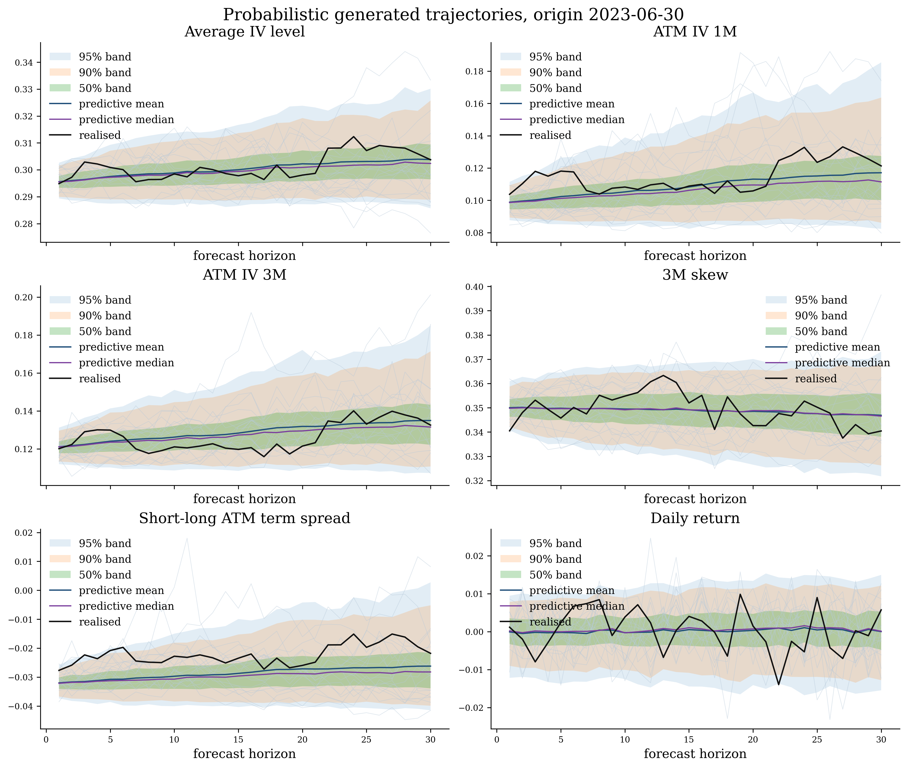

# Arbitrage-Aware Probabilistic Multi-Step Forecasting of Implied Volatility Surfaces

### Joint Generation of Surface-Return Trajectories Using Latent Diffusion

**Dominik Manuel Buchegger · Lukas Gonon**  
University of St.Gallen

[](https://arxiv.org/abs/2608.22478)
[](#paper)
[](https://colab.research.google.com/github/DomBBB/implied-volatility-trajectories/blob/main/ICAIF26/ICAIF.ipynb)
[](../LICENSE)

**Generate joint 30-day trajectories of SPX implied volatility surfaces and index returns from 21 days of observed surface history and the current market state.**

The implementation combines an arbitrage-aware surface autoencoder with a conditional latent diffusion model. It produces complete future paths and predictive distributions, together with ensemble means that can be compared with the strong surface-persistence baseline.

**Reported result:** the predictive mean reduces aggregate surface RMSE by **6.09%** relative to persistence, with improvements concentrated beyond the shortest horizons.



*Illustrative joint surface–return forecasts; Figure 5 of the [paper](https://arxiv.org/html/2608.22478v2#S5.F5).*

[Paper](#paper) · [Main results](#main-results) · [Method](#method) · [Run the notebook](#run-the-notebook) · [Data and experiment](#data-and-experiment) · [Release scope](#release-scope) · [Citation](#citation)

## Paper

**Accepted at the 7th ACM International Conference on AI in Finance (ICAIF 2026).** Conference proceedings are forthcoming.

- [arXiv abstract and latest version](https://arxiv.org/abs/2608.22478)
- [PDF](https://arxiv.org/pdf/2608.22478)
- [HTML](https://arxiv.org/html/2608.22478v2)
- [Implementation notebook](ICAIF.ipynb)

## Main results

Results below are reported in the paper for the held-out **2023–August 2025** sample, with **637 forecast origins** and **1,000 DDPM trajectories per origin**. Surface errors are measured in time-scaled implied volatility, $\Xi=\sqrt{\tau}\sigma$, on the observed lattice.

| Forecast horizon | Model-mean RMSE | Persistence RMSE | RMSE reduction |
| :-- | --: | --: | --: |
| All 30 horizons | 0.01262 | 0.01343 | **6.09%** |
| 1 day | 0.00619 | 0.00535 | −15.72% |
| 5 days | 0.01017 | 0.01043 | 2.52% |
| 10 days | 0.01223 | 0.01305 | 6.28% |
| 21 days | 0.01367 | 0.01459 | 6.29% |
| 30 days | 0.01460 | 0.01567 | **6.83%** |

*Table 6 of the paper. Positive reductions indicate lower error. Percentage gains are reproduced as reported; displayed RMSE values are rounded.*

- **Probabilistic quality:** at 30 days, average-IV CRPS improves by **10.5%** over the historical-change bootstrap benchmark.
- **Economic admissibility:** **98.8%** of ensemble-mean surfaces and **88.5%** of individual DDPM surfaces have no detected static-arbitrage violations under the paper's grid checks.

The main limitations are weaker one-day point forecasts and underdispersed predictive intervals.

## Method

1. **Construct daily surfaces.** Map irregular SPX option quotes to a common lattice with the bundled pretrained Operator Deep Smoothing model. Work with standardised log time-scaled IV and retain an observation mask.
2. **Learn an eight-dimensional surface state.** A residual CNN encoder and a Fourier-feature, FiLM-conditioned neural-field decoder reconstruct the surface. Derivative penalties encourage butterfly and calendar-spread consistency.
3. **Generate joint future paths.** A Transformer denoiser models anchored latent displacements and daily log returns jointly. It conditions on 21 observed latent states, the current latent level and return, and 27 market-state features.
4. **Adjust the latent mean and decode.** A conditional, horizon-specific gate blends the latent ensemble mean with persistence while retaining the original latent residuals. Decode each adjusted latent path to obtain a surface trajectory.

The entire forecast horizon is generated jointly rather than by rolling a one-step point forecast forward. The default model uses four Transformer blocks, width 128, four attention heads, and a 500-step linear diffusion schedule with $v$-prediction. The autoencoder and diffusion model are fitted separately for 200 and 100 epochs; the mean gate is fitted for 15 epochs after the denoiser is frozen.

## Run the notebook

### Requirements

- A Google Colab runtime with Google Drive access; a CUDA GPU is recommended for training and generation.
- A WRDS account with the relevant **OptionMetrics IvyDB US** access.
- The standard libraries imported in the notebook: PyTorch, NumPy, pandas, Matplotlib, and tqdm. Notebook setup cells install the specialised WRDS, graph, tensor-container, and option-pricing dependencies.
- Sufficient host memory and storage for the requested forecast ensembles. Sampling and decoding use chunks, but the final archive retains the complete ensembles in memory before saving.

The notebook imports the **bundled smoothing implementation** and loads its supplied pretrained checkpoint. The forecasting autoencoder and diffusion checkpoints are produced by the notebook or reused from the configured Drive folder.

### Workflow

1. Open [ICAIF.ipynb in Colab](https://colab.research.google.com/github/DomBBB/implied-volatility-trajectories/blob/main/ICAIF26/ICAIF.ipynb) and select a GPU runtime.
2. Run the environment cells, mount Google Drive, and choose the project folder. The default is `MyDrive/IVS`.
3. Run data retrieval and surface construction. WRDS authentication is interactive; existing annual downloads and processed files are reused.
4. Run dataset construction, autoencoder fitting or loading, latent encoding, and diffusion fitting or loading in notebook order.
5. Run forecast generation to save the joint latent, surface, and return trajectories with their dates and normalisation metadata.

The default generation cell requests **1,000 draws for each of two samplers**: 500-step DDPM and 50-step DDIM. The paper's reported results use DDPM. For an exploratory run, use a smaller ensemble before generating the complete archive; changing these settings defines a different sampling experiment.

### Saved artifacts

Paths are relative to the chosen Drive project folder.

| Artifact | Default path |
| :-- | :-- |
| Raw option quotes and index closes | `data/raw/` |
| Annual smoother caches | `data/opDsCache/` |
| Annual smoothed surfaces | `data/opDsProcessed/` |
| Consolidated surfaces and return features | `data/processed/` |
| Autoencoder checkpoint | `RAE_FINAL_vF.pt` |
| Diffusion checkpoint, including the mean gate | `DIFF_FINAL_vF.pt` |
| Generated forecast archive | `diffusion_dump_vF.pt` |

Existing checkpoints and archives are loaded or skipped according to the notebook's file-existence checks. Use distinct artifact paths when comparing configurations.

Decoded surface arrays in the archive store **normalised log time-scaled IV**, not ordinary IV. The archive also stores the location and scale needed to recover $\Xi$; divide by $\sqrt{\tau}$ to recover ordinary IV. Returns are de-standardised daily log returns.

## Data and experiment

The dataset is built from OptionMetrics end-of-day SPX quotes and index prices using `secid=108105`. Its observed lattice contains **170 maturity–moneyness coordinates**, with maturities from one to twelve months. Raw OptionMetrics data are not distributed in this repository; licensed users can reconstruct the inputs using the notebook.

The paper selects models using training data through 2021 and validation data from 2022, then refits the final models on the combined period through 2022. This notebook contains that **final refit configuration**. Its retained 2022 validation dataset overlaps the refit period; the final fitting calls pass no validation loader.

The paper's data snapshot ends on **29 August 2025**, as recorded in the notebook's saved split summary. Match this cutoff before constructing the datasets for a comparable experiment: the annual WRDS queries cover 2000–2025, and a fresh download can contain later observations. Complete 30-day targets must fit within each split.

## Release scope

This release covers data preparation, autoencoder and diffusion-model training, and trajectory generation. **Evaluation scripts are not included in this release.** The results above are reported from the paper, rather than recomputed by the released notebook.

| File or directory | Purpose |
| :-- | :-- |
| [ICAIF.ipynb](ICAIF.ipynb) | Main data, training, and generation workflow |
| [operator-deep-smoothing/](operator-deep-smoothing/) | Bundled smoothing implementation and pretrained smoothing checkpoint |
| [assets/](assets/) | Paper illustration used in this README |

## Citation

If this implementation or method is useful in your research, please cite the paper.
Machine-readable metadata is available in [CITATION.cff](CITATION.cff).

```bibtex
@misc{buchegger2026arbitrageaware,
  title         = {Arbitrage-Aware Probabilistic Multi-Step Forecasting of Implied
                   Volatility Surfaces: Joint Generation of Surface-Return
                   Trajectories Using Latent Diffusion},
  author        = {Dominik Manuel Buchegger and Lukas Gonon},
  year          = {2026},
  eprint        = {2608.22478},
  archivePrefix = {arXiv},
  primaryClass  = {q-fin.MF},
  url           = {https://arxiv.org/abs/2608.22478},
  note          = {Accepted at ICAIF 2026}
}
```

## Acknowledgements and license

Surface construction uses [Operator Deep Smoothing for Implied Volatility](https://arxiv.org/abs/2406.11520) and its [upstream implementation](https://github.com/rwicl/operator-deep-smoothing-for-implied-volatility). This directory contains the version used by the notebook; see its [README](operator-deep-smoothing/README.md) and retained upstream notices.

Project source code is provided under the [MIT License](../LICENSE). The reproduced paper figure is attributed to Buchegger and Gonon (2026), Figure 5, under the paper's [CC BY 4.0 license](https://creativecommons.org/licenses/by/4.0/). The source-code license does not grant access to or redistribution rights for the underlying OptionMetrics data.

For questions about the implementation, [open an issue](https://github.com/DomBBB/implied-volatility-trajectories/issues).
